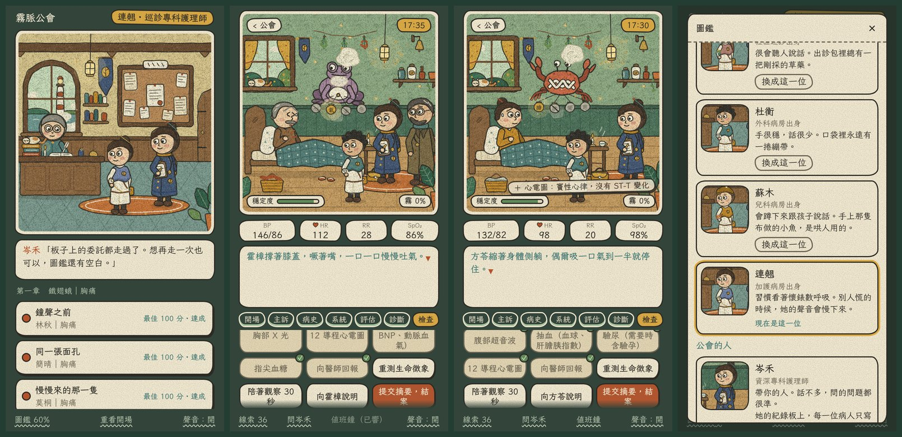
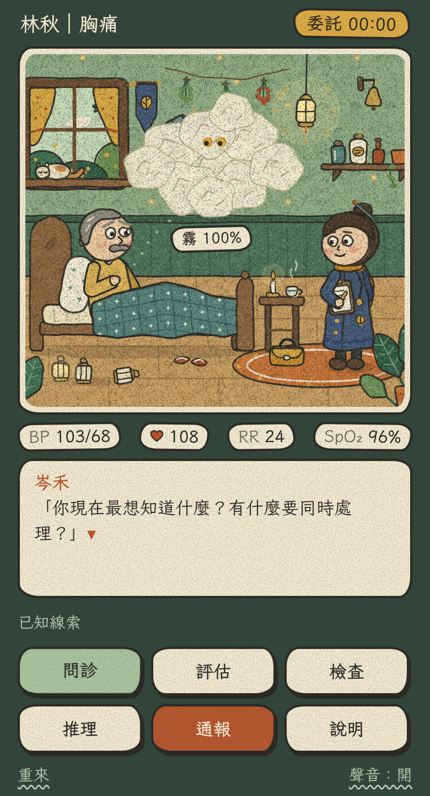
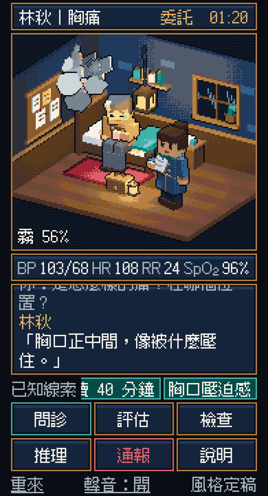

# np-games1

給專科護理師（NP）學員的臨床推理遊戲。方向：**回合制的 NP OSCE 角色扮演遊戲。你是霧脈公會的見習專科護理師，每一關是一個主訴，在時限內照臨床推理的步驟把它拆開。世界是奇幻的，臨床是真的。**

## 現在做到哪

工作順序是 **設計目標 → 架構 → 內容**，每一階段確認了才往下。

| 階段 | 文件 | 狀態 |
|---|---|---|
| 1. 設計目標 | [`docs/01-design-goals.md`](docs/01-design-goals.md) | ✅ v1.5 |
| 1. 遊戲企劃 | [`docs/05-game-design.md`](docs/05-game-design.md) | ✅ v2 已確認。對齊甄審、不猜題的題庫做法、世界觀、主線、玩法、評分 |
| 2. 架構：遊戲規則 | [`docs/02-architecture.md`](docs/02-architecture.md) | ✅ 設計已確認，可以玩的空殼做好了：[`game/`](game/README.md) |
| 2. 架構：整體系統 | [`docs/04-system-design.md`](docs/04-system-design.md) | 🟡 靜態版做好了：離線可玩、可以裝到手機、中途離開可以接著做、進度匯出匯入、自動檢查和部署（第 9 節）。匿名的使用統計也做好了，要另外設定才會開。遊戲和後端一起放在 Cloudflare（[`worker/`](worker/README.md)），已經上線，之後每次合併都會自動更新。可以用 LINE 或 Google 登入同步進度（選用；LINE 已經開了）。有回報問題的管道和隱私說明 |
| 3. 內容：美術方向 | [繪本版](prototypes/style-frame-storybook/README.md) | ✅ 定案：手繪繪本風（2026-11-12）。[3D 像素版](prototypes/style-frame/README.md)留著當紀錄 |
| 3. 內容：互動原型 | [`app/`](app/README.md) | 🟡 五章加終章、十二隻症影、48 張委託（教案的十二個主訴都有了，每個主訴四個診斷各一位）；一章換一個地方（公會在霧港的五個診間）；終章是三輪分流和燈塔的一位病人；六位主角可以選；圖鑑四頁；第二章走完升階、少一層提示，等你試玩 |
| 3. 內容：長期的推進 | [`docs/06-progression.md`](docs/06-progression.md) | 🟡 故事線、圖鑑、階級的設計。五章和終章都做了；接下來怎麼補完整在第 10 節 |
| 3. 內容：病例 | [怎麼寫新病例](app/src/data/README.md) | 🟡 病例模組和教案轉換工具做好了；49 個病例（十二個主訴各四，加終章一位）和三輪分流題都是草稿，還沒經過臨床老師審查 |
| 3. 內容：審查清單 | [`docs/review/`](docs/review/README.md) | 🟡 給臨床老師的清單，從病例檔產生；等老師審 |

## 互動原型



繪本畫風的可以玩的版本。序章之後從六位見習專科護理師裡選一位當主角。

| 章 | 症影（主訴） | 委託 |
|---|---|---|
| 第一章 | 胸悶蛾（胸痛） | 林秋、簡晴、莫桐、阮舟：四個人是四個不同的診斷 |
| 第二章 | 氣促蛙（喘） | 駱松（心衰竭）、霍樟（慢性阻塞性肺病急性惡化）、柯蒲（肺炎）、岳楊（氣胸） |
| 第二章 | 腹痛蟹（腹痛） | 方苓（膽囊炎）、邵棠（闌尾炎）、龔椿（胰臟炎）、鄔桃（憩室炎） |
| 第三章 | 發熱蜥（發燒） | 溫荷（腎盂腎炎）、涂柏（傷口感染合併敗血症）、池榆（懷疑肺結核）、尤杉（藥物熱） |
| 第三章 | 頭痛鳥（頭痛） | 喬芸（偏頭痛）、魏葵（蜘蛛膜下腔出血）、賀楓（細菌性腦膜炎）、季蘭（腦內佔位病灶） |
| 第四章 | 腰背龜（背痛） | 石竹（下背拉傷）、甘棗（輸尿管結石）、藍桂（馬尾症候群）、辛桑（腹主動脈瘤） |
| 第四章 | 跛足鷺（腳痛） | 戚杏（痛風）、樂梧（急性下肢動脈阻塞）、孟榛（腔室症候群）、祁柳（坐骨神經痛） |
| 第四章 | 水腫豚（腫脹） | 紀蓮（腎病症候群）、穆槐（心衰竭合併肺水腫）、譚菊（肝硬化腹水）、包梨（深部靜脈栓塞） |
| 第五章 | 二便獺（排泄物異常） | 寧樺（潰瘍出血）、聞檀（大腸直腸的腫瘤）、厲芹（無痛性血尿）、雷榕（阻塞性黃疸） |
| 第五章 | 皮疹魷（皮膚疹子） | 鄒薇（帶狀疱疹）、韋茜（過敏性休克）、麥萱（紅斑性狼瘡）、申蓉（血小板低下紫斑） |
| 第五章 | 消瘦鼠（體重減輕） | 晏梅（甲狀腺亢進）、屠楠（胃的腫瘤）、席橘（克隆氏症）、裴柚（老年憂鬱） |
| 第五章 | 麻木鰻（感覺異常） | 汪茗（糖尿病神經病變）、焦菱（缺血性腦中風）、鮑藤（B12 缺乏的脊髓病變）、祝葦（過度換氣） |

每一張委託照考站的順序走：**問診（開場、主訴、病史、系統回顧）→ 評估（從頭到腳五個模組）→ 診斷 → 檢查**。症影底下掛著四盞燈，拿到關鍵的線索要判斷它讓哪一盞更像、哪一盞比較不像；解讀對的線索會寫回圖鑑。圖鑑另外有「人物」和「場景」兩頁，遇到的人、去過的地方（例如出診的碼頭貨棧）會一張一張打開。

問診和評估的骨架參考臨床老師的 OSCE 教案，文字是重寫的。手上有教案的話，`app/tools/convert_script.py` 可以先轉出一份病例的底稿。

```bash
cd app
```

```bash
npm install
```

```bash
npm run dev
```

怎麼玩、程式怎麼分、還沒有什麼，看 [`app/README.md`](app/README.md)。

## 風格定稿

同一個場景做過兩種畫風來對照，最後選了繪本版。

| 繪本版（定案） | 3D 像素版（紀錄） |
|---|---|
|  |  |
| [`prototypes/style-frame-storybook/`](prototypes/style-frame-storybook/README.md) | [`prototypes/style-frame/`](prototypes/style-frame/README.md) |

## 舊的空殼

架構階段做的 2D 版本，已經被 `app/` 取代，留著當紀錄。


```bash
npx serve game
```

細節看 [`game/README.md`](game/README.md)：怎麼檢查、怎麼加病例、病例檔格式、規則的數值。

這個空殼的直式操作太多下、回饋太弱。整體系統設計確認後，規則核心留用，畫面會重做。

## 先前的探索（sepsis 自走棋方向，留著當參考）

- 最早的設計文件：[`docs/GDD-v0.md`](docs/GDD-v0.md)
- 3D 可行性評估：[`docs/PLAN-3D.md`](docs/PLAN-3D.md)
- 2D 灰盒原型：[`prototypes/sepsis-greybox/`](prototypes/sepsis-greybox/README.md)（完整流程和研究紀錄；用瀏覽器打開 `index.html` 就能玩）
- 3D 視覺試作：[`prototypes/sepsis-3d/`](prototypes/sepsis-3d/README.md)（佈陣和自動處置；`npx serve prototypes/sepsis-3d`）
- 3D 模型產生器：[`tools/blender/`](tools/blender/README.md)

> 本遊戲為教學用的簡化模型，不能取代臨床判斷和院內 protocol。
