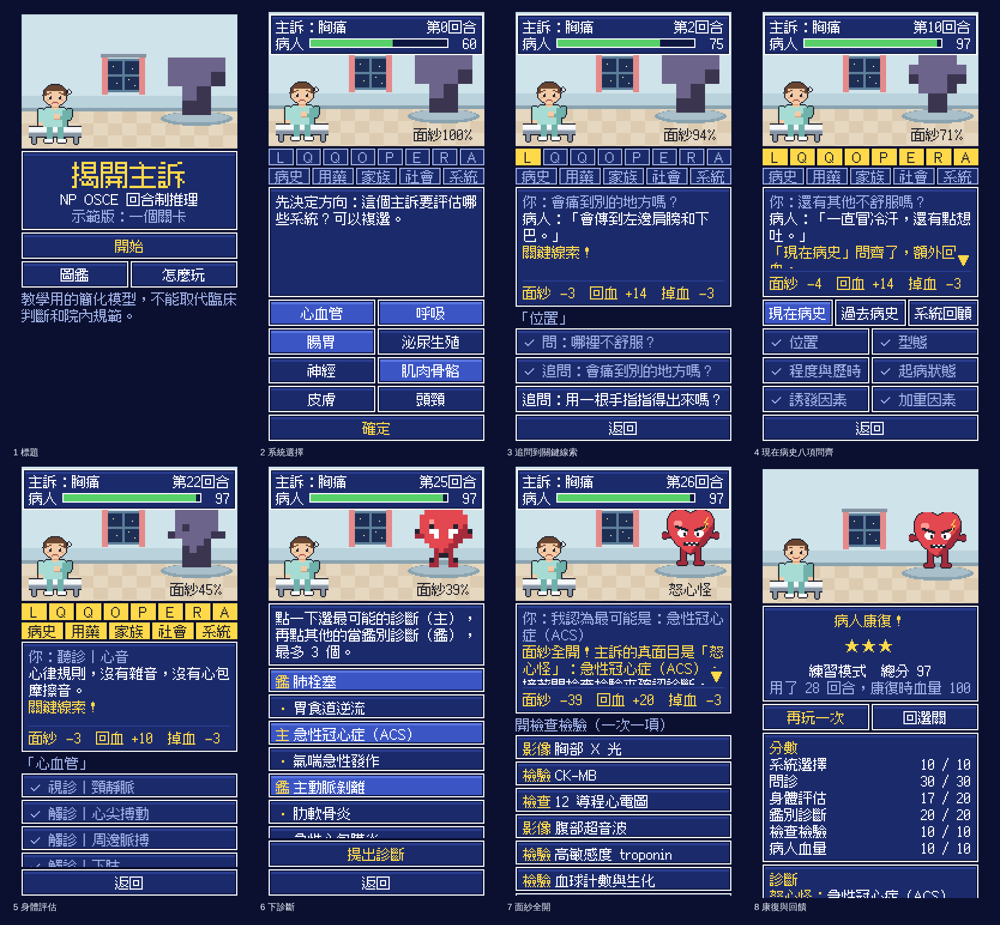

# np-games1

給專科護理師（NP）學員的臨床推理遊戲。方向：**像素風、回合制的 NP OSCE 遊戲。每一關是一個主訴，照臨床推理的步驟把它拆開，最後自己提出鑑別診斷。**

## 現在做到哪

工作順序是 **設計目標 → 架構 → 內容**，每一階段確認了才往下。

| 階段 | 文件 | 狀態 |
|---|---|---|
| 1. 設計目標 | [`docs/01-design-goals.md`](docs/01-design-goals.md) | ✅ 定稿 v1.1 |
| 2. 架構：遊戲規則 | [`docs/02-architecture.md`](docs/02-architecture.md) | ✅ 設計已確認，可以玩的空殼做好了：[`game/`](game/README.md) |
| 2. 架構：整體系統 | [`docs/04-system-design.md`](docs/04-system-design.md) | 🟡 草稿，等確認。前端、後端、程式結構，以及直式為什麼卡 |
| 3. 內容：美術方向 | [`docs/03-art-options.md`](docs/03-art-options.md) | ✅ 選定 B（十六位元 RPG）。正式的圖還沒畫 |
| 3. 內容：病例 | 只有一個示範關卡，還沒經過專家審查 | ⏸ |

## 玩玩看



```bash
npx serve game
```

細節看 [`game/README.md`](game/README.md)：怎麼檢查、怎麼加病例、病例檔格式、規則的數值。

這個空殼的直式操作太多下、回饋太弱。整體系統設計確認後，規則核心留用，畫面會重做。

## 先前的探索（sepsis 自走棋方向，留著當參考）

- 最早的設計文件：[`docs/GDD-v0.md`](docs/GDD-v0.md)
- 3D 可行性評估：[`docs/PLAN-3D.md`](docs/PLAN-3D.md)
- 2D 灰盒原型：[`prototypes/sepsis-greybox/`](prototypes/sepsis-greybox/README.md)（完整流程和研究紀錄；用瀏覽器打開 `index.html` 就能玩）
- 3D 視覺試作：[`prototypes/sepsis-3d/`](prototypes/sepsis-3d/README.md)（佈陣和自動處置；`npx serve prototypes/sepsis-3d`）
- 3D 模型產生器：[`tools/blender/`](tools/blender/README.md)

> 本遊戲為教學用的簡化模型，不能取代臨床判斷和院內 protocol。
