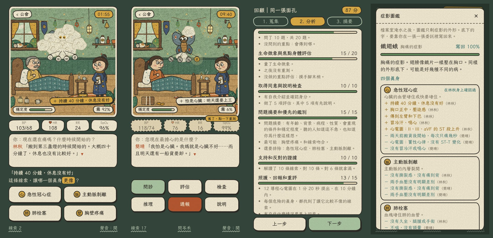

# 霧脈公會：互動原型

繪本畫風的可以玩的版本。第一章有兩張委託，是同一隻症影（胸痛）的兩個真身：林秋和簡晴。從公會接案玩到關後回顧，圖鑑會跟著寫回來。



## 怎麼跑

```bash
npm install
```

```bash
npm run dev
```

其他指令：

| 指令 | 做什麼 |
|---|---|
| `npm test` | 規則和評分的測試（27 項） |
| `npm run cases` | 檢查所有病例，印出一張總表 |
| `npm run check` | 型別檢查 |
| `npm run build` | 型別檢查之後打包到 `dist/`，是純靜態檔，放到任何主機都能跑 |

需要 Node 22.18 以上（測試直接跑 TypeScript，不用另外編譯）。字體從 Google Fonts 載入。

## 一張委託怎麼走

1. **公會**：故事的段落、委託板、圖鑑。完成一張委託，下一張才會貼上板子。
2. **閱題**：病人的資料，和進門前先想的三件事。
3. **病室**：症影底下掛著四盞燈，是四個可能的真身。
   - 問診 21 題、生命徵象和 9 項身體評估、5 項檢查與資料。
   - **解讀**：拿到關鍵的線索，要選它讓哪一個真身更像或比較不像。選對，霧才散、那盞燈才亮或暗掉；選錯，岑禾會說為什麼。
   - **岑禾的提問**：解讀到第三條，她會問一次「你最擔心哪一個」。
   - 推理板：一句問題摘要，最可能的和還要排除的。
   - 通報：敲值班鐘、向值班醫師回報。說明：向病人說明，然後結案。
4. **回顧**：蒐集（哪一刻最影響判斷）→ 分析（分數、每一項的理由、你的想法怎麼變）→ 摘要（選一件下次要做到的事、這一關寫回圖鑑的線索）。

幾個刻意的設計：

- **時間只在做行動的時候走。** 看字、解讀線索、排推理板都不扣時間。
- **沒量過就是不知道。** 生命徵象一開始沒有數字；病人變差之後要重測才知道。
- **兩位病人的選項一模一樣，真身不一樣。** 林秋拖過第 4 分鐘沒通報會變差；簡晴很穩定，敲值班鐘反而是過度通報，要做的是把危險的真身一個一個排除。
- **回報的內容來自你問到的東西。** 沒問他擔心什麼，說明的時候就沒有那一句可以選。
- **圖鑑只收你自己解讀對的線索。**

長期怎麼推進（故事、圖鑑、階級），看 [`docs/06-progression.md`](../docs/06-progression.md)。

## 程式怎麼分

```
src/
  core/      規則核心：不碰畫面、沒有亂數、不看真實時間，也不認得任何一個特定的病例
    types.ts     病例格式（第 3 版）和對局的狀態
    module.ts    主訴模組 + 病例 → 完整的病例
    engine.ts    perform(病例, 對局, 行動) → 新的對局 + 發生的事
    scoring.ts   評分（55 / 45）、安全狀態、回顧和圖鑑用的資料
    validate.ts  病例檢查器
    autoplay.ts  照病例的資料走出理想的打法，用來驗證病例
  data/      內容：主訴模組（chest-pain.ts）、病例（c01a.ts、c01b.ts）、目錄（index.ts）
             怎麼寫新病例：data/README.md
  art/       繪本風的畫：色盤和畫筆、角色、病室、公會大廳（Canvas，沒有圖檔）
  ui/        畫面（React）：公會、病室、各種紙片、回顧；progress.ts 管故事、解鎖和圖鑑
tools/
  cases.ts   npm run cases
```

規則核心和畫面是分開的：畫面只做兩件事，把行動送進 `perform`，把回傳的事件演出來。
之後要把規則搬到伺服器（答案不送到瀏覽器），`core/` 可以原封不動搬過去。

## 還沒有的

- 只有第一章的兩張委託。胸痛的第三位病人、其他主訴、資格試煉（真實倒數 15 分鐘）都還沒做。
- 沒有伺服器。進度存在這台裝置的瀏覽器裡；**病例的答案現在在瀏覽器裡看得到**，正式版要搬到伺服器。
- 真身、回報和說明都是從清單選，還不能自己寫。
- 提示還沒有照階級一層一層拿掉（設計在 `docs/06-progression.md` 第 7 節）。
- 心電圖只有文字結果，沒有波形。

## 要知道的

- **病例還沒經過臨床老師審查，不能當教材。** 時間限制、分數的權重、哪些算安全行動，都是我依指引先訂的草稿。
- 畫是用程式畫的，角色、房間和構圖都是為這個專案重新設計的。
- 在真的手機上試過一次：系統字體調大的時候文字會疊在一起、對話被切掉。已經把版面改成跟著字的大小伸縮，並在模擬手機上用字放大 1.25 倍重測過（385×700、390×760、375×600、844×390）；改完之後，以及加了解讀和圖鑑之後，還沒有在真的手機上再確認。
- 遊戲的分數是訓練用的，不代表正式甄審的成績。

## 病例的出處

- Gulati, M., et al. (2021). 2021 AHA/ACC/ASE/CHEST/SAEM/SCCT/SCMR guideline for the evaluation and diagnosis of chest pain. *Circulation, 144*(22), e368–e454. https://doi.org/10.1161/CIR.0000000000001029
- Rao, S. V., et al. (2025). 2025 ACC/AHA/ACEP/NAEMSP/SCAI guideline for the management of patients with acute coronary syndromes. *Journal of the American College of Cardiology, 85*(22), 2135–2237. https://doi.org/10.1016/j.jacc.2024.11.009

兩篇的書目資料都用 PubMed 核對過。
