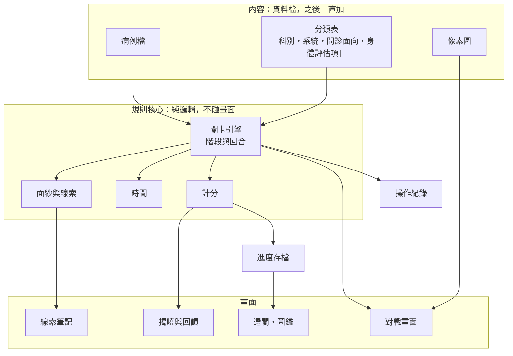
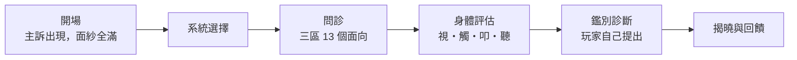

# 階段 2：架構（草稿，待你確認）

> 2026-11-11｜依據 [設計目標 v1.0](01-design-goals.md)。這一頁只定「遊戲由哪些系統組成、怎麼接在一起」，不寫病例、數值和美術。文中的數字都是示意，內容階段才定。

---

## 1. 全貌



三層分開的好處：加病例只動「內容」；調規則只動「規則核心」，而且有自動測試保護；換美術只動「畫面」。

---

## 2. 一關怎麼進行

對應 CDSS 的步驟，一關分五個階段：



| 階段 | 玩家每一回合做什麼 | 對面紗的影響 |
|---|---|---|
| 系統選擇 | 選出這個主訴該評估哪些系統 | 決定後面系統回顧和身體評估的範圍 |
| 問診 | 選一個面向來問，或對問過的面向追問 | 每得到一條線索，面紗薄一層 |
| 身體評估 | 選系統、手法、部位 | 每得到一個發現，面紗再薄一層 |
| 鑑別診斷 | 從候選清單選出最可能的診斷和鑑別診斷 | 面紗完全揭開，露出真面目 |
| 揭曉與回饋 | 看結果 | — |

每個動作都花時間。玩家做完一個動作，換「主訴」的回合：時間往前走，病人說出回答。

---

## 3. 核心系統

### 3.1 面紗與線索

- 面紗是「還不知道的程度」，從 100% 開始。每得到一條新線索就下降，關鍵線索降得多。
- 畫面上，主訴是一隻被馬賽克蓋住的怪物。面紗越薄，馬賽克越細，最後看得出牠是誰。這是像素風最自然的表現方式。
- 陷阱案例：一開始的輪廓會讓人以為是 A，找到關鍵線索後才變成 B。
- 所有線索自動記到「線索筆記」，依問診三區和身體評估分類，旁邊有覆蓋燈號顯示哪些面向問過了。

### 3.2 問診：全面，但仍然有選擇

目標是「三區都要問到」。如果只是把 13 個按鈕按一遍，就不是遊戲了。所以分成兩層：

| 層 | 規則 | 玩家的判斷 |
|---|---|---|
| **廣度（必做）** | 13 個面向每個至少問一次，燈才會亮 | 沒有捷徑，就是要問完 |
| **深度（自選）** | 有些面向可以追問，關鍵線索常藏在追問裡。追問要多花時間 | 依目前的線索，決定哪幾個面向值得追問 |

| 區 | 面向 |
|---|---|
| 現在病史（LQQOPERA） | 位置、型態、程度與歷時、起病狀態、誘發因素、加重因素、緩解因素、伴隨症狀 |
| 過去病史 | 過去病史、用藥與過敏、家族史、社會史 |
| 系統回顧（ROS） | 依「系統選擇」選的系統逐一回顧 |

- 一整區問齊有小獎勵（例如退回一點時間）。這是保留下來的「湊齊一套有加成」。
- **練習模式**：13 個面向都問過，才能進鑑別診斷。沒問到的面向會提示。
- **OSCE 模式**：不擋、不提示。但沒問到的面向會扣分，也拿不到滿分。

### 3.3 身體評估

- 只評估和主訴相關的系統，範圍來自「系統選擇」。
- 每一項是「系統 × 手法 × 部位」，做了就得到一個發現。
- 照常規順序做有加成：視診 → 觸診 → 叩診 → 聽診；腹部是視診 → 聽診 → 叩診 → 觸診。

### 3.4 時間

- 每個動作花固定的時間。OSCE 模式有總時間，練習模式不限時。
- 時間預算的原則：**問完 13 個面向加上重點身體評估，一定做得完**；剩下的時間才是拿來追問的。病例檔的檢查工具會驗證這一點。

### 3.5 鑑別診斷

- 玩家從候選清單裡選：一個最可能的診斷，加上幾個鑑別診斷。清單裡有干擾選項。
- 病例檔會標出「不能漏掉的危險診斷」，漏了會在回饋裡特別指出。

### 3.6 計分與過關

| 軸 | 看什麼 |
|---|---|
| 系統選擇 | 該評估的系統有沒有選到 |
| 問診 | 13 個面向的覆蓋，加上關鍵追問 |
| 身體評估 | 該做的有沒有做、順序對不對 |
| 鑑別診斷 | 主診斷、鑑別診斷、危險診斷 |
| 效率 | 用了多少時間 |

**過關條件**：主診斷正確，而且問診三區都問到。每一關依總分給一到三顆星。

### 3.7 選關、進度、圖鑑

- 選關的層次：科別（內科、外科）→ 系統 → 主訴。每個主訴標示難度（初、中、高）和類型（典型、陷阱）。
- **圖鑑**：過關後，那個診斷的怪物收進圖鑑，附上它的重點特徵。圖鑑就是學員自己累積的疾病筆記。
- 進度存在玩家自己的瀏覽器，不收個人資料。

### 3.8 兩種模式

| | 練習 | OSCE |
|---|---|---|
| 時間 | 不限 | 計時 |
| 覆蓋燈號和提示 | 有 | 沒有 |
| 回饋 | 每個階段結束就給 | 整關結束才給 |
| 問診沒問完 | 不能進鑑別診斷 | 可以，但扣分 |

---

## 4. 一個病例檔長什麼樣

一個病例一個檔。下面是結構示意，內容是佔位文字，不是真的病例。

```json
{
  "id": "im-cv-001",
  "specialty": "內科",
  "systems": ["心血管"],
  "difficulty": "中",
  "type": "典型",
  "chief_complaint": "〈主訴〉",
  "patient": { "age": 0, "sex": "〈性別〉", "setting": "〈場景〉" },
  "system_selection": { "core": ["〈系統〉"], "important": ["〈系統〉"], "optional": ["〈系統〉"] },
  "interview": {
    "onset": {
      "answer": "〈病人的回答〉",
      "weight": 1,
      "follow_ups": [
        { "ask": "〈追問〉", "answer": "〈回答〉", "key": true, "weight": 3 }
      ]
    }
  },
  "physical_exam": [
    { "system": "〈系統〉", "technique": "聽診", "site": "〈部位〉", "finding": "〈發現〉", "key": true, "weight": 3 }
  ],
  "differential": [
    { "name": "〈診斷〉", "role": "主診斷", "supported_by": ["onset.follow_ups.0"] },
    { "name": "〈診斷〉", "role": "不能漏掉" },
    { "name": "〈診斷〉", "role": "干擾" }
  ],
  "trap": null,
  "teaching": { "points": ["〈教學重點〉"], "sources": ["〈出處〉"] }
}
```

要點：

- 每條線索有權重，決定面紗降多少。
- 鑑別診斷標出是哪些線索支持它，回饋時才能說明「這個診斷是靠哪幾條線索推出來的」。
- 每個病例必填出處。
- 另有一個檢查工具，加新病例時自動檢查：欄位齊不齊、13 個面向有沒有都寫、時間預算夠不夠、主診斷有沒有足夠的關鍵線索支持。

---

## 5. 技術架構

| 決定 | 選擇 | 理由 |
|---|---|---|
| 平台 | 瀏覽器，手機優先 | 不用安裝 |
| 畫面 | 像素場景用畫布，文字和選單用一般網頁元素 | 中文字清楚，選單好維護 |
| 遊戲引擎 | 不用現成引擎 | 回合制選單遊戲用不到物理和即時運算，少一層依賴 |
| 程式 | JavaScript 模組，不需要建置步驟 | 改完存檔就能看到結果 |
| 規則核心 | 純邏輯，和畫面分開，有自動測試 | 改規則不怕改壞 |
| 內容 | 一個病例一個 JSON 檔，加上檢查工具 | 加病例不用改程式 |
| 存檔 | 玩家自己的瀏覽器 | 獨立遊戲，不收個資 |
| 操作紀錄 | 每個動作都記下來，先只用在回饋 | 之後要做研究，加匯出就好 |
| AI | 不用 | 結果固定、可重現、沒有費用 |

資料夾的安排：

```
game/
  index.html
  core/           規則核心：關卡引擎、面紗、時間、計分，加上測試
  data/
    taxonomy.json 分類表：科別、系統、問診面向、身體評估項目
    cases/        一個病例一個檔
  ui/             畫面
  art/            像素圖
tools/
  validate-cases  病例檢查工具
```

先前 sepsis 方向的 `prototypes/` 和 `tools/blender/` 留著不動。

### 像素美術要先定的框架

| 項目 | 規劃 |
|---|---|
| 畫面 | 固定的低解析度畫布，整數倍放大，邊緣保持銳利 |
| 圖的種類 | 病人、玩家角色、每個診斷的「真面目」、場景、圖示 |
| 面紗效果 | 用程式把真面目的解析度降低，不用另外畫 |
| 中文字 | 需要一套授權乾淨的繁體中文像素字體。找不到合適的，內文就用一般字體，只有標題和數字用像素字 |

---

## 6. 架構階段做到哪裡算完成

1. 這份文件你確認。
2. 做出一個**空殼**：一個示範關卡可以從選關玩到揭曉，內容和美術都是佔位的。
3. 病例檔的格式定版，檢查工具可以用。
4. 規則核心有自動測試。

之後進內容階段，才開始寫真的病例、畫真的像素圖。

---

## 7. 要請你決定的三件事

1. **問診的規則**（§3.2）：13 個面向都要問到，另外可以追問。練習模式沒問完不能下診斷，OSCE 模式不擋但扣分。這樣可以嗎？
2. **壓力來源**：第一版我建議只有「時間」。病人狀況會惡化的急症關卡留到之後。可以嗎？
3. **「架構處理完」的範圍**（§6）：我的理解是做出可以玩的空殼，內容和美術先用佔位的。對嗎？
