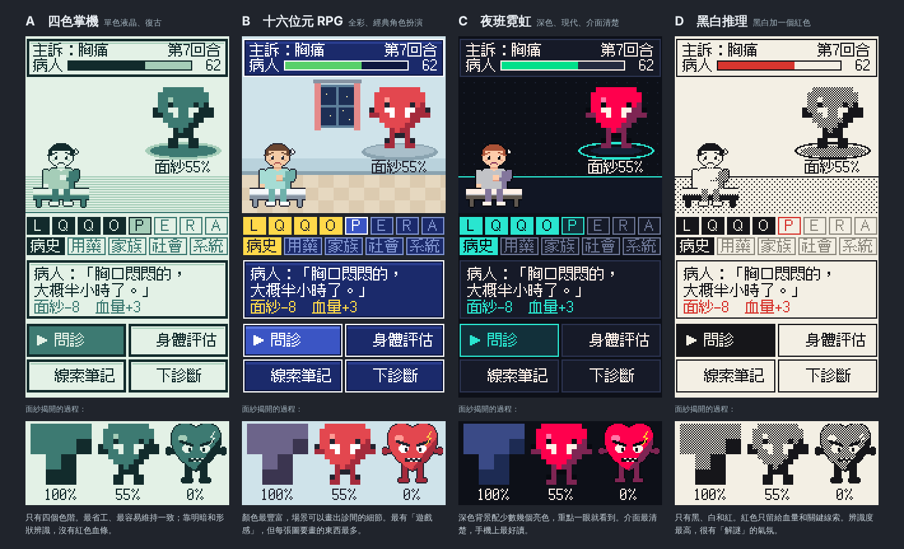

# 美術方向：四種像素風格（已選定 B）

> 2026-11-11｜同一個畫面、同一組圖，只換調色盤和介面畫法，方便比較風格。畫面內容是示意，不是真的病例。

## 決定：B（十六位元 RPG）

2026-11-11 選定。遊戲的空殼（[`game/`](../game/README.md)）已經照 B 做：診間場景、深藍色的對話框、綠色血條、金色的燈號和重點。

選 B 要先知道的事，下面的比較表也有寫：

- B 要畫的東西最多。場景、病人、每個診斷的真面目都要有細節。
- 沒有專職美術的情況下，風格最難維持一致。
- 現在遊戲裡的圖還是用程式畫的佔位圖，只有一位病人和一隻主訴怪。正式的圖在內容階段畫。

下面是當時的四個選項，留著當紀錄。



每張圖的上半是遊戲畫面：上方是主訴和病人血量，中間是病人和被馬賽克蓋住的主訴怪，下面兩排是 13 個問診面向的燈號，再下面是病人的回答和四個指令。下半是面紗從 100% 揭開到 0% 的樣子。

---

## 四個選項

| | A 四色掌機 | B 十六位元 RPG | C 夜班霓虹 | D 黑白推理 |
|---|---|---|---|---|
| 感覺 | 單色液晶掌機，復古 | 全彩，經典角色扮演 | 深色、現代 | 黑白加一個紅色，像解謎遊戲 |
| 顏色數 | 4 個色階 | 二十幾個 | 十幾個亮色配深色底 | 黑、白、紅 |
| 血量看不看得清楚 | 普通。沒有紅色，只能靠明暗 | 清楚 | 清楚 | **最清楚**。紅色只給血量和關鍵線索 |
| 13 個燈號好不好讀 | 普通 | 好 | **最好** | 好 |
| 能不能用顏色分類（三區、各系統） | 不能 | 能 | 能 | 不能 |
| 製作成本 | 最低 | **最高**，場景和角色都要畫細節 | 中 | 低 |
| 風格一致的難度 | 容易 | 難，沒有專職美術容易參差不齊 | 中 | 容易 |
| 辨識度 | 中 | 中，這類遊戲很多 | 中 | **最高** |

## 我的建議

**第一選 C（夜班霓虹），第二選 D（黑白推理）。**

- 這款遊戲的資訊很多：血量、面紗、13 個面向、各系統、關鍵線索。C 可以用顏色把它們分開，手機上最好讀。
- D 最有特色，製作成本也最低，而且「紅色只留給血量」剛好強調核心機制。缺點是不能用顏色分類，長時間看白底比較刺眼。
- B 最有遊戲感，但要畫的東西最多。只有你和我的情況下，品質最難維持一致。
- A 很有味道，但血量是這款遊戲的核心，少了紅色比較吃虧。

也可以混搭，例如 C 的介面配 B 的全彩角色。

## 要先說清楚的事

- 四張圖用的是**同一組圖**（病人和心臟怪），都是我用程式畫的佔位圖。它們代表的是「我做得出來的水準」，不是完成品。選定風格後會重畫一整套。
- 心臟怪只是示範面紗怎麼揭開，不代表之後每個診斷都長這樣。
- 這些是靜態示意圖，還不能玩。

## 字體

畫面上的中文是 **Fusion Pixel Font**（作者 TakWolf，SIL OFL 1.1 授權，可以免費使用和內嵌），12 像素、繁體中文版。示意圖是從第三方打包的版本載入的；正式做的時候會改從原作者的版本取用，只打包遊戲用得到的字。

## 怎麼重現這張圖

原始檔是 [`art/pixel-styles/index.html`](art/pixel-styles/index.html)，所有圖都在裡面用程式畫出來。用瀏覽器透過網頁伺服器打開就能看：

```bash
npx serve docs/art/pixel-styles
```

網址加上 `?scale=3` 可以放大，加上 `?only=neon` 只看其中一種（`gb`、`rpg`、`neon`、`bit`）。

## 接下來美術要決定的事

進內容階段再談，不擋現在的進度：

- 病人要畫幾種（年齡、性別），還是先共用一位。
- 每個診斷的真面目要怎麼設計，才能看得出是它，又不會太嚇人。
- 場景要不要分急診、門診、病房。
