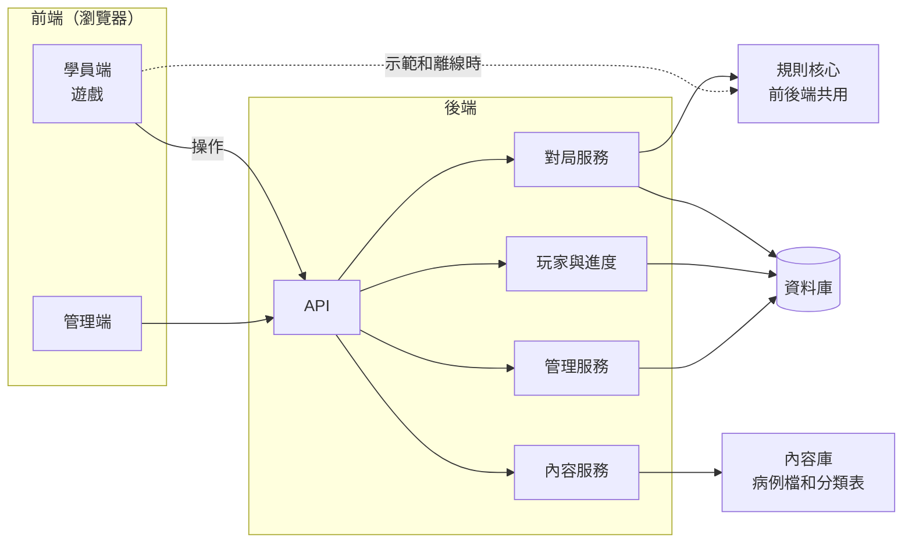
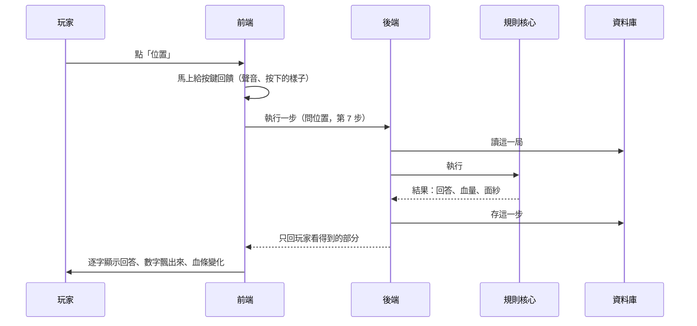
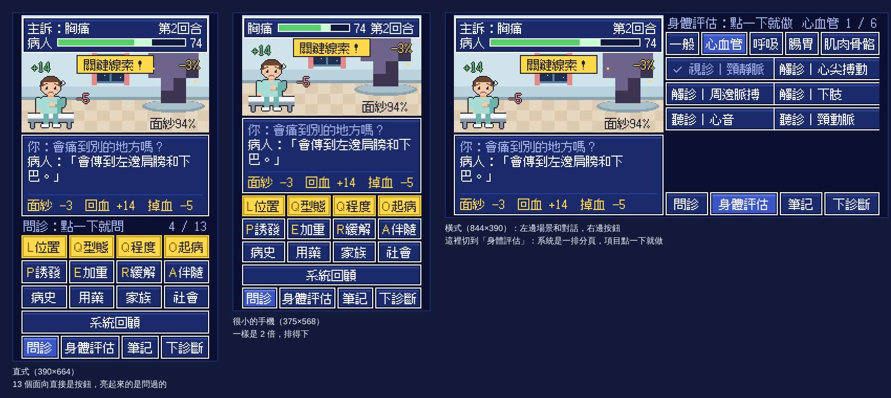

# 整體系統設計（草稿，等你確認）

> 2026-11-11｜起因有兩個：(1) 你要的是一套完整的系統，有前端、後端和完整的程式設計，不是只有一個遊戲畫面；(2) 直式玩起來又卡又差，回饋不夠。
>
> 這一頁先把整個系統想清楚。**你確認之前，我不動程式。** 現在的 [`game/`](../game/README.md) 是架構階段的空殼，規則核心會留用，畫面會重做。

> **2026-11-12 補充：互動原型做好了，有一個決定要你定。**
>
> [`app/`](../app/README.md) 是照企劃 v2 做的第一個可以玩的版本，還沒有伺服器。規則核心（`app/src/core/`）是純 TypeScript，和畫面完全分開，這一頁第 3 節「伺服器主導、答案不送到瀏覽器」的設計不變。
>
> 要定的是**後端用什麼語言**：
>
> | | 做法 | 好處 | 代價 |
> |---|---|---|---|
> | A（我的建議） | 後端也用 TypeScript，放在 Cloudflare | 規則只有一份，瀏覽器和伺服器跑同一段程式，「同樣的操作一定得到同樣的分數」最容易保證；你說過放 Cloudflare 沒差 | 和 CDSS 不是同一套後端 |
> | B | 後端用 FastAPI（Python），和 CDSS 一樣 | 部署和維護的經驗可以沿用 | 規則要用 Python 再寫一份，兩份要一直對齊，測試也要兩套 |
>
> 這個決定不影響現在的原型。你定了之後，這一頁再照企劃 v2 整頁改寫。

---

## 1. 直式為什麼卡：量到的結果

我用無頭瀏覽器模擬手機直式，把運算速度放慢到中階手機的程度來量。

| 量了什麼 | 結果 | 判斷 |
|---|---|---|
| 點下去到畫面更新 | 30–60 毫秒（運算放慢 6 倍時） | 不慢。卡不是運算造成的 |
| 問完 13 個面向要點幾下 | **44 下**，平均一題 3.4 下（選面向 → 問 → 返回） | **太多。這是「卡」的主因** |
| 視窗高度不到 640 像素時 | 放大倍數掉到 1.5 倍：字變小、像素不整齊、只用到 77% 的寬度 | **這是「差」的主因。** App 內嵌的檢視器常常就是這個高度 |
| 手機橫放 | 只用到 24% 的寬度，字只有 12 像素 | 不能用 |
| 桌機 | 只用到 31% 的寬度 | 浪費 |
| 每個動作的回饋 | 換一段文字，主訴怪閃 0.1 秒。沒有聲音、沒有動態、沒有震動 | **這是「回饋不高」的原因** |
| 畫一次場景 | 16 毫秒（運算放慢 4 倍時），剛好一格畫面的時間 | 現在幾乎沒有動畫所以沒事。要加動畫就一定會掉格 |
| 第一次載入 | 767 KB，其中字體 653 KB | 偏重 |

還沒辦法確認的：我量不到你那支手機實際的狀況。如果你遇到的是「按了沒反應」或「捲動卡住」，請告訴我，那是另一類問題（見最後的問題 3）。

對策寫在第 4 節。

---

## 2. 系統全貌

### 2.1 誰在用

| 角色 | 做什麼 |
|---|---|
| 學員 | 玩關卡、看回饋、累積圖鑑和進度 |
| 管理者（你） | 看整體使用狀況、看每一局的紀錄、管理關卡要不要上架 |
| 內容作者和審查者 | 寫病例、檢查病例、標記審查狀態 |

### 2.2 由哪些部分組成



### 2.3 四個最重要的設計決定

**(1) 對局由伺服器主導，答案不送到瀏覽器。**
現在整份病例檔（包含正確診斷、哪些線索是關鍵、哪些檢查必要）都送到瀏覽器，打開開發者工具就看得到。當玩具可以，當 OSCE 或要留可信的紀錄就不行。
改成：瀏覽器只送「我做了什麼」，伺服器跑規則核心，只回「你看得到的東西」。

**(2) 規則核心只有一份，前後端共用。**
規則核心是純邏輯，同樣的操作一定得到同樣的結果。所以後端用 JavaScript（Node），直接跑同一份程式，不用另外用別的語言重寫一套。
這也表示伺服器只要存「操作紀錄」，隨時可以重播出整局的狀態和分數。

**(3) 前端只認「對局服務」這一個介面。**
它有兩種接法：連後端（正式用），或在瀏覽器裡直接跑規則核心（示範、離線、開發時用）。畫面的程式不用知道是哪一種。

**(4) 匿名優先。**
預設不收任何個人資料。第一次打開時產生一個匿名的玩家代碼，進度跟著代碼走。要不要做實名登入或班級，由你決定（見最後的問題 1）。

---

## 3. 後端

### 3.1 技術

| 項目 | 選擇 | 理由 |
|---|---|---|
| 語言 | JavaScript（Node 22） | 和規則核心同一種語言，直接共用 |
| 網頁框架 | Hono | 很小，在自己的主機和 Cloudflare 都能跑，之後換地方不用重寫 |
| 資料庫 | SQLite 類（自己的主機用 SQLite，Cloudflare 用 D1） | 你熟悉 SQLite 的運作方式；資料量不大 |
| 資料存取 | 透過一個「儲存介面」，後面可以換記憶體、SQLite、D1 | 測試用記憶體，上線再決定放哪裡 |

### 3.2 模組

```
server/
  app.js            路由和中介層（驗證身分、限流、輸入檢查、錯誤處理）
  services/
    sessions.js     對局：開局、執行一步、接續、結束
    catalog.js      內容：分類表和關卡清單（不含答案）
    players.js      匿名玩家、進度、圖鑑
    admin.js        管理端的查詢、重播、匯出
  storage/
    port.js         儲存介面的定義
    memory.js       測試用
    sqlite.js       自己的主機用
    d1.js           Cloudflare 用
  content/
    loader.js       啟動時讀內容庫、檢查、算版本
```

### 3.3 API（第 1 版）

| 方法和路徑 | 做什麼 |
|---|---|
| `GET /api/health` | 健康檢查，回報程式版本和規則版本 |
| `POST /api/players` | 建立匿名玩家，回傳通行碼（只給這一次） |
| `GET /api/catalog` | 分類表和關卡清單：主訴、科別、難度、類型、審查狀態。**沒有答案** |
| `POST /api/sessions` | 開一局（哪一關、哪個模式） |
| `GET /api/sessions/:id` | 拿目前的狀態。重新整理或斷線後可以接續 |
| `POST /api/sessions/:id/actions` | 執行一步。帶序號，網路重送不會算兩次 |
| `GET /api/sessions/:id/result` | 結束後拿分數和檢討 |
| `GET /api/me/progress` | 每一關的最佳成績、圖鑑 |
| `GET /api/admin/...` | 管理端：總覽、每一局的紀錄和重播、病例檢查狀態、匯出 |

### 3.4 一步操作怎麼走



網路慢的時候，按鍵回饋還是立刻出現，回答的字則是等回來才開始打。這段等待就是「病人在想」。

### 3.5 什麼時候看得到什麼

| 時間點 | 看得到 | 看不到 |
|---|---|---|
| 選關 | 主訴、科別、難度、類型 | 診斷 |
| 對局中 | 自己問到的回答、做過的評估結果、血量和面紗的變化、候選診斷的名稱、檢查檢驗的名稱 | 線索的權重、哪些是關鍵線索、每個診斷的角色、哪些檢查必要、沒問到的回答 |
| 對局中（練習模式多給的） | 燈號、「關鍵線索」的提示、順序提醒、還沒問到的面向 | 同上 |
| 過關後 | 全部：診斷、每條線索的解說、教學重點、出處 | — |
| 失敗後 | 過程的檢討：漏了幾個面向、哪幾回合白過 | 診斷和解說（留著再挑戰） |

這張表會寫成自動測試：對局中回給前端的資料裡，不准出現表上「看不到」的欄位。

### 3.6 資料

| 資料表 | 存什麼 |
|---|---|
| `players` | 匿名玩家代碼、通行碼的雜湊、建立時間 |
| `case_versions` | 每一版病例的完整內容和雜湊。病例改過，舊的紀錄還是對得到當時的版本 |
| `sessions` | 一局：誰、哪一關的哪一版、模式、規則版本、程式版本、開始和結束時間、結果、分數 |
| `session_actions` | 一局裡的每一步：序號、做了什麼、結果、時間 |
| `admins` | 管理者帳號 |

每一局都記下病例版本、規則版本和程式版本，所以任何一局都能重播，分數算得出一樣的結果。之後如果要做研究，這些欄位就是分析時分組的依據。

### 3.7 安全和隱私

- 匿名玩家的通行碼是隨機產生的，資料庫只存雜湊。
- 不收姓名、電子郵件、裝置資訊。
- 每個來源有請求次數上限；輸入都檢查格式和長度。
- 管理端另外登入。
- **如果之後要做研究**，要先處理同意書和 IRB，並決定資料保存方式。這一版只把紀錄的結構留好，不把它當研究資料。

---

## 4. 前端

### 4.1 對戰畫面重新設計：少點幾下

| | 現在 | 改成 |
|---|---|---|
| 問一個面向 | 選面向 → 問 → 返回，3 下 | **13 個面向直接是按鈕，1 下** |
| 追問 | 進面向選單再選 | 已經問過的面向再點一下，就地展開追問 |
| 身體評估 | 選系統 → 選項目 → 返回 | 系統是上面一排分頁，項目點一下就做，不用返回 |
| 四個指令 | 每次要回到主選單 | 固定在畫面最下面，拇指按得到 |
| 問完 13 個面向 | 44 下 | **13 下** |



圖是版面示意，不是做好的畫面。

### 4.2 直式、橫式、桌機都要能用

| 情況 | 現在 | 改成 |
|---|---|---|
| 直式手機 | 高度不夠就掉到 1.5 倍，字小、像素不齊 | 只用整數倍。版面在 568 像素高（很小的手機）也排得下 |
| 橫式手機 | 只用 24% 的寬度 | 左邊場景和對話，右邊按鈕 |
| 桌機 | 只用 31% 的寬度 | 用橫式版面，放大到 3 或 4 倍 |

### 4.3 回饋：每個動作都要有感覺

| 發生什麼 | 畫面 | 聲音 | 震動 |
|---|---|---|---|
| 按任何按鈕 | 按鈕往下壓 | 短促的一聲 | 很輕 |
| 病人回答 | 字一個一個打出來，點一下可以直接看完 | 打字聲 | — |
| 得到線索 | 主訴怪被打到、晃一下；馬賽克當場變細；面紗的數字往下跳 | 命中聲 | 輕 |
| 關鍵線索 | 金色火花、「關鍵線索！」的橫幅 | 特別的音效 | 中 |
| 回血 | 綠色的「+7」從病人身上飄起來；血條慢慢長回去 | 回復聲 | — |
| 主訴攻擊（掉血） | 主訴怪往前撲；病人晃一下；紅色的「−5」飄出來 | 受擊聲 | 輕 |
| 血量很低 | 血條閃紅、畫面邊緣泛紅 | 心跳聲 | — |
| 白白過了一回合 | 主訴怪頭上冒「…」，沒有命中的效果 | 悶悶的一聲 | — |
| 一整區問齊 | 那一排按鈕一起亮一下 | 小段旋律 | 中 |
| 診斷正確 | 畫面閃白，馬賽克一層一層剝掉，名字的橫幅滑進來 | 揭曉的音樂 | 強 |
| 診斷錯誤 | 畫面震動、泛紅 | 錯誤聲 | 強 |
| 康復 | 主訴怪消失，病人站起來笑；星星一顆一顆出現 | 勝利的音樂 | 中 |

聲音用程式合成的電子音，不需要音檔，也不花錢。設定裡可以關聲音、關震動、減少動畫。iPhone 的瀏覽器不支援震動，那邊只有畫面和聲音。

### 4.4 效能目標

| 項目 | 目標 | 現在 |
|---|---|---|
| 按下去到看見回饋 | 100 毫秒以內 | 30–60 毫秒，但回饋本身太弱 |
| 動畫 | 中階手機每秒 60 格 | 還沒有動畫 |
| 畫一次場景 | 2 毫秒以內（圖先畫好存起來，之後直接貼） | 16 毫秒 |
| 第一次載入 | 300 KB 以內（字體只打包用得到的字） | 767 KB |

這些目標會寫成量測腳本，每次改完都能再量一次。

### 4.5 程式結構

```
web/
  app.js            啟動、換頁、版面（直式或橫式）
  store.js          畫面的狀態，集中在一個地方
  services/
    game-remote.js  對局服務：連後端
    game-local.js   對局服務：在瀏覽器裡跑規則核心
  views/            標題、選關、對戰、結果、圖鑑、設定
  scene/            像素場景：圖的快取、每一格的繪製
  fx/               動態：時間軸、數字飄字、粒子、震動
  audio/            合成音效
  art/              像素圖和字體
admin/              管理端（另一個入口）
```

繼續不用建置步驟，檔案改完存檔就能看。型別用註解標，交給檢查工具在自動檢查時把關。

---

## 5. 程式整體設計

### 5.1 資料夾

```
core/        規則核心：規則、關卡引擎、計分、「玩家看得到什麼」、病例檢查
content/     內容庫：分類表、病例檔
server/      後端
web/         學員端
admin/       管理端
tools/       檢查、字體打包、效能量測
tests/       端對端測試（直式、橫式各一套）
docs/        文件
prototypes/  先前的探索，留著不動
```

現在的 `game/core` 搬到 `core/`，`game/data` 搬到 `content/`，`game/ui` 重做成 `web/`。

### 5.2 測試

| 測什麼 | 怎麼測 |
|---|---|
| 規則 | 現有的 32 個測試，繼續加 |
| 答案不外流 | 對局中回給前端的資料，不准出現第 3.5 節「看不到」的欄位 |
| 重播一致 | 用存下來的操作紀錄重播，狀態和分數要和當時一樣 |
| API | 用記憶體資料庫，把每個路徑打一遍，包含錯的輸入和重送 |
| 病例 | 現有的檢查工具，每個病例自動試玩 |
| 畫面 | 無頭瀏覽器把整關玩完：直式、橫式、桌機 |
| 手感 | 量測腳本：點幾下、反應時間、每格畫面的時間、載入大小 |

每次推上去，這些都自動跑一遍。

### 5.3 放在哪裡跑

| 選項 | 費用 | 你要顧什麼 | 適合 |
|---|---|---|---|
| A. Cloudflare（免費額度） | 免費額度內不用錢 | 幾乎不用顧 | **我的建議**：符合「不花錢」，也不用管主機 |
| B. 你自己的主機（Docker） | 主機的錢 | 更新、備份、憑證 | 想把資料完全放在自己手上 |
| C. 先不上線 | 0 | — | 只在本機和示範連結上跑，後端先做好放著 |

不管選哪個，**不要和 CDSS 的正式機放在一起**。那台機器上是研究資料，不該讓一個還在開發的遊戲影響它。

程式的寫法讓 A、B 之間可以換，不用重寫。

---

## 6. 對先前決定的影響

| 先前的決定 | 會不會變 |
|---|---|
| 像素風、回合制、對應 CDSS 的步驟、問診要全面、病人掉血 | 不變 |
| 獨立的遊戲，不連到 CDSS | 不變。它有自己的後端和資料庫 |
| 不用 AI | 不變 |
| 一個病例一個檔，加病例不用改程式 | 不變 |
| 不用建置步驟 | 不變 |
| 用瀏覽器玩，手機優先 | 不變，加上橫式和桌機 |
| 進度只存在玩家的瀏覽器 | **改**：存在後端，跟著匿名代碼走 |
| 第一版不做帳號系統 | **改**：要有匿名玩家代碼。實名登入和班級先不做，除非你要 |
| 操作紀錄留在瀏覽器 | **改**：存在後端，可以重播 |
| 人力只有你和我，不花錢 | 不變，所以主機建議用免費額度 |
| 架構階段的空殼 | 規則核心留用，畫面重做 |

設計目標那一頁我加了兩條（G12、G13），標成等你確認：[`01-design-goals.md`](01-design-goals.md)。

---

## 7. 做的順序

每一步做完都給你看，確認了才往下。

| 步驟 | 做什麼 | 你會拿到什麼 |
|---|---|---|
| 1. 手感 | 新的對戰畫面：直式、橫式、回饋、效能。先在瀏覽器裡跑規則核心，不需要後端 | 一個連結，在手機上試直式好不好玩 |
| 2. 程式重整 | 資料夾搬家、對局服務的介面、「玩家看得到什麼」和它的測試、型別檢查、自動檢查 | 結構整理好的程式，測試全過 |
| 3. 後端 | API、資料庫、伺服器主導對局、匿名玩家和進度 | 在本機可以跑的完整系統，前端連後端玩完一關 |
| 4. 管理端 | 總覽、每一局的紀錄和重播、病例檢查狀態 | 你看得到大家怎麼玩的畫面 |
| 5. 上線 | 部署、離線可玩、字體打包 | 一個正式的網址 |
| 6. 內容 | 病例和正式的像素圖 | 原本的內容階段 |

手感排第一，因為那是你現在實際遇到的問題，而且它不受下面三個決定影響。

---

## 8. 三件事的結果（2026-11-11）

| 問題 | 你的回答 |
|---|---|
| 玩家身分做到哪裡 | 不急。先用匿名代碼 |
| 放在哪裡跑 | 都可以。先用 Cloudflare |
| 「卡」是哪一種 | 更大的問題是故事和設計跟你想的落差很大 |

所以做的順序改了：**先定 [遊戲企劃](05-game-design.md)**（世界觀、角色、主線、開場、動態、美術定調），再回來做第 7 節的步驟。

**2026-11-11 更新**：遊戲企劃 v2 建議前端用 React、後端用 FastAPI，和你的 CDSS 同一套。這一頁第 3 節寫的是 JavaScript 後端，企劃確認後我會改寫這一頁。原則不變：對局由伺服器主導，答案不送到瀏覽器，每一局都能重播。

如果美術確定走「3D 像素」，第 4 節的場景會改用 3D 繪圖來畫，文字和按鈕不變。試煉的 15 分鐘沙漏也要加進對局服務：時間由伺服器算，不信任瀏覽器回報的時間。

下面是當時問的原文，留著當紀錄。

### 當時的三個問題

1. **玩家身分做到哪裡？**
   A. 匿名代碼，不收個資（我的建議）。
   B. 登入制：你發邀請碼或編號，像 CDSS 那樣。
   C. 再加上班級和教師端。
   選 B 或 C 會碰到個資，要先想同意書；如果是給研究用，還要 IRB。

2. **放在哪裡跑？** 第 5.3 節的 A（Cloudflare 免費額度）、B（你自己的主機）、C（先不上線）。

3. **你說的「卡」，比較像哪一種？**
   A. 要點太多下，一直進選單、退選單。
   B. 按了沒感覺，不確定有沒有按到。
   C. 畫面太擠、字被切掉、要一直捲。
   D. 真的延遲或停頓：按了過一下才有反應。
   我量到的是 A、B、C。如果是 D，請告訴我是用什麼裝置、在哪裡開的（Claude 的 App 裡，或一般瀏覽器），我會另外查。

---

## 9. 先做靜態版（2026-11-12）

你說「想先把系統做出來，靜態的可以嗎」。可以，而且已經做了。

**靜態版是什麼**：整個遊戲是一包檔案（一頁 HTML、一個程式檔、一個樣式檔、兩個字體檔、幾張圖示），放到任何能放檔案的主機就能跑。沒有伺服器、沒有資料庫、沒有帳號，不花錢。規則核心在瀏覽器裡跑，就是第 2.3 節決定 (3) 留的那一種接法。

### 9.1 原本的設計，在靜態版變成什麼

| 第 2、3 節原本要的 | 靜態版怎麼做 | 少了什麼 |
|---|---|---|
| 對局由伺服器主導，答案不送到瀏覽器 | 規則核心在瀏覽器裡跑 | **答案在瀏覽器裡看得到**，分數也可以自己改。當練習工具可以；當考試、或要留可信的成績，不行 |
| 匿名玩家代碼，進度存在後端 | 進度存在裝置上。換裝置用「匯出／匯入」帶過去 | 不會自動同步。清掉瀏覽器資料就沒有了 |
| 操作紀錄存在後端，可以重播 | 只存「還沒結案的那一場」，中途離開回來可以接著做 | 你看不到大家怎麼玩 |
| 管理端 | 沒有 | 使用狀況、每一局的紀錄都看不到 |
| 內容服務 | 病例跟著程式一起打包 | 改一個字也要重新部署。部署是自動的，合併之後就會做 |
| 上線：部署、離線可玩、字體打包 | 都做了 | — |

### 9.2 做了哪些

| 項目 | 做法 | 程式在哪 |
|---|---|---|
| 離線可玩 | 第一次打開的時候把整個遊戲存在裝置上（service worker），之後沒有網路也能開、能玩 | `app/tools/sw.template.js`、`app/tools/static.ts` |
| 裝到手機 | 可以加到主畫面，打開是全螢幕，有自己的圖示 | `app/public/manifest.webmanifest`、`app/tools/icons.mjs` |
| 換版 | 新版在背景下載好，大廳出現「有新的版本」；玩家自己按了才換上，不會在委託做到一半的時候跳掉 | `app/src/ui/pwa.ts` |
| 中途離開可以接著做 | 每做一個行動就存一次。手機把頁面收掉、不小心關掉分頁、按了「回公會」，回來都接得上 | `app/src/ui/store.ts`、`App.tsx` |
| 進度帶著走 | 「設定」裡匯出一份（存成檔案，或是一段可以複製貼上的文字），到另一台裝置匯入 | `app/src/ui/backup.ts`、`Settings.tsx` |
| 字體跟著遊戲走 | 建置的時候從完整的字體檔裡只留遊戲用到的字（兩個字重，各約 0.6 MB）。不再連到 Google Fonts，所以玩家打開遊戲不會連到遊戲以外的任何網站 | `app/tools/static.ts` |
| 自動檢查 | 每次推送都跑：測試、每個病例走得到滿分、審查清單和病例對得上、型別檢查、建置 | `.github/workflows/app.yml` |
| 自動部署 | 合併到 main 之後，遊戲和後端一起自動部署到 Cloudflare（第 9.3 節） | 同上，[`worker/`](../worker/README.md) |

第一次打開要下載大約 1.7 MB（程式壓縮後約 0.4 MB，兩個字體檔共約 1.3 MB）。300 個人用，對靜態主機沒有負擔。

### 9.3 放到哪裡（2026-11-13 改成 Cloudflare）

**遊戲和後端放在同一個 Cloudflare Worker、同一個網址底下**（[`worker/`](../worker/README.md)，免費方案）。遊戲的靜態檔由 Cloudflare 直接給；`/api/` 底下的才交給後端的程式。

2026-11-12 原本先選 GitHub Pages：那時候沒有後端，程式又已經在 GitHub 上。隔天改成 Cloudflare，因為要做 Google 登入和進度同步（第 9.5 節），後端一定要有、Cloudflare 的帳號一定要開，合在一起比較簡單：

| | GitHub Pages 加一個 Worker | 全部放 Cloudflare |
|---|---|---|
| 遊戲和後端 | 兩個不同的網址，要處理跨網站的限制 | 同一個網址 |
| 設定和部署 | 兩邊各一套 | 一個帳號、一次部署 |
| 免費的網址 | 綁 GitHub 的帳號名稱 | `mist-guild.某個名字.workers.dev` |
| 自己的網域 | 手動加 DNS 記錄，HTTPS 最久等一天 | 網域放在 Cloudflare 就能直接掛 |
| repo | 免費方案要公開才能用 | 公開、私人都可以 |

代價：Cloudflare 的金鑰變成必要的（原本只有統計需要）；`workers.dev` 這類免費網址，有些機構的網路可能會擋，所以還是建議之後掛自己的網域。

要你做的事（我沒有權限替你做），細節在 [`worker/README.md`](../worker/README.md)：

1. Cloudflare 的帳號和子網域（子網域的名字會出現在網址裡）。
2. 建一把 Cloudflare 的 API 金鑰，和帳號代號一起放進 GitHub 的 secrets。
3. 把這個 PR 合併到 main。合併之後幾分鐘就部署好，網址印在流程的摘要裡。

一放上去就是公開的：知道網址的人都能玩。病例還沒有經過臨床老師審查，這一點遊戲裡有寫（接委託之前、設定頁），但要不要現在就公開，由你決定。

**之後怎麼更新**：把修改合併到 main 就會自動部署。玩家下次打開的時候新版在背景下載好，大廳出現「有新的版本」，按了才換上；進度留著。**唯一會讓玩家的進度不見的是換網址**（進度跟著網址存在裝置上），所以網址要在把連結發給學員之前決定好。

### 9.4 靜態版要知道的幾件事

- **iPhone 的 Safari**：隔太久沒有打開，Safari 可能會把網站存的資料清掉，進度就沒有了。加到主畫面比較保險。另外，主畫面的圖示和 Safari 的進度是分開存的。這兩點設定頁裡有寫給玩家看。
- **在 LINE 裡打開**：LINE 內建的瀏覽器通常不能安裝、存檔也常失敗。所以匯出另外做了「複製文字」這一條路。建議請學員用 Safari 或 Chrome 開。
- **使用資料要另外開**。靜態版本身不知道有多少人玩、玩到哪裡。要看，照第 9.6 節把匿名統計開起來。
- **答案看得到**。會開開發者工具的人看得到每一關的診斷和配分。

### 9.5 什麼時候才需要伺服器

碰到下面任何一件，才值得加：

| 需要 | 最小的做法 |
|---|---|
| 想知道有多少人玩、哪一關卡住 | 一個只收「匿名的統計數字」的小端點。**已經做了，見第 9.6 節**；遊戲本身還是靜態的 |
| 老師要看每位學員的紀錄 | 先試不用伺服器的做法：學員匯出一份紀錄交給老師。不夠再做帳號 |
| 換裝置自動同步 | Google 登入（選用）加後端存檔，放在同一個 Worker。裝置上的進度還是主要的那一份，雲端只當備份。做法談過了（2026-11-13），**還沒做** |
| 當成考試、留可信的成績 | 對局由伺服器主導，答案不送到瀏覽器（第 2.3 節的決定 (1)）。這是最大的一步 |

碰到個資（實名、班級）就要先想同意書；給研究用還要 IRB。這一點和第 8 節當時說的一樣。

### 9.6 匿名的使用統計（2026-11-12）

你說可以加。做法是一個很小的端點，放在 Cloudflare 的那個 Worker 裡（[`worker/`](../worker/README.md)，`/api/` 底下），遊戲本身不變。2026-11-13 起它和遊戲在同一個網址底下。

| 項目 | 做法 |
|---|---|
| 沒有設定的時候 | 遊戲不詢問、不回傳。預設就是這樣 |
| 設定之後 | 玩家第一次進大廳被問一次。選「可以回傳」才送；選之前一筆都不送；選「不要」，裝置上的代號和還沒送的都清掉。「設定」裡隨時可以改 |
| 回傳什麼 | 隨機的裝置代號、哪一版、手機還是電腦、哪一張委託、做到第幾段、分數、安全行動、花了多久、問了岑禾幾次 |
| 不回傳什麼 | 姓名、帳號、選了哪些句子、任何文字、每一步的操作。端點不存 IP，不認得的欄位會丟掉 |
| 沒有網路的時候 | 先留在裝置上，恢復網路再送。同一件事重送不會算兩次 |
| 你怎麼看 | 遊戲的網址後面加 `#stats`，輸入管理密碼：總覽、每一關（幾台接過、幾台結案、第一次的平均分、離開時停在哪一段）、每一天、玩得多深、用什麼玩。可以下載 CSV |
| 資料放哪裡 | Cloudflare 的 Durable Object（裡面是 SQLite）。部署只要一個指令，不用另外建資料庫 |

**要你做的設定**（寫在 [`worker/README.md`](../worker/README.md)）：部署本來就要的兩個 secret 之外，再放一個 `STATS_ADMIN_KEY`（看總表用的密碼）。有放，下一次部署起遊戲才會詢問、回傳；沒有放就完全不會。金鑰和管理密碼都是你自己放進 GitHub 的，不會經過我。

**要知道的限制**：

- 數字只包含選了「可以回傳」的人，不是全部的玩家。
- 匿名的端點擋不住有心人灌水。看趨勢可以，不能當成精確的數字。
- 「裝置」不等於「人」：同一個人換手機或清掉瀏覽器資料，會算成兩台。
- **這是營運用的統計，不是研究資料。** 之後如果要寫進研究或發表，要先經過 IRB，同意的說明也要照 IRB 核准的版本改；現在這個詢問不算研究的知情同意。
