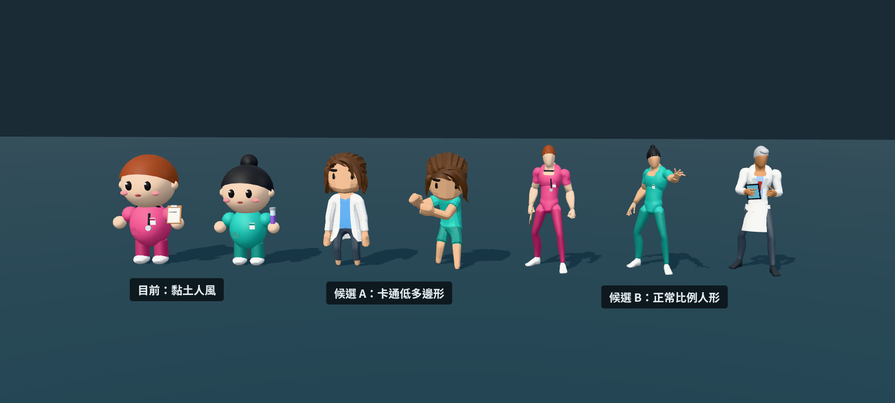
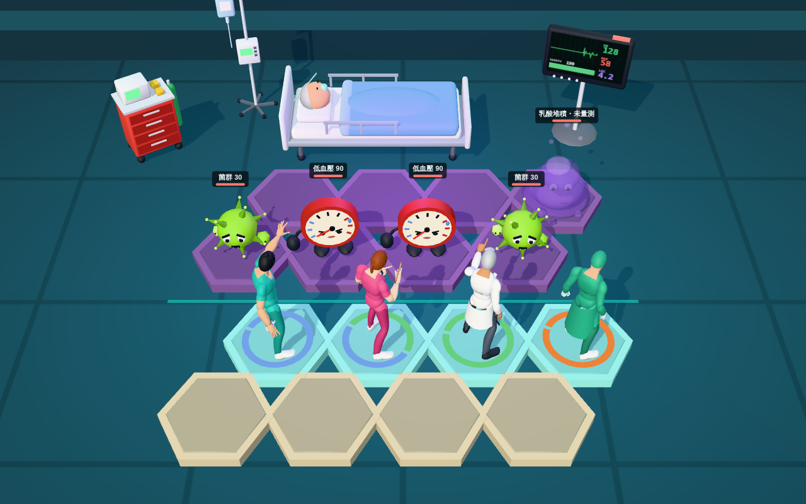

# 美術方向 v2：不要黏土人

> ⏸ **暫緩**：工作順序改為「設計目標 → 架構 → 內容」。這份是階段 3（內容）的草稿，等 [`01-design-goals.md`](01-design-goals.md) 確認後再回來處理。

> 2026-11-11｜回應「美術要加強、不要有黏土人的感覺」。先做了風格候選給你挑，**還沒有重做整套**，等你選了再動手。

---

## 1. 三種風格並排

| | 目前 | 候選 A | 候選 B |
|---|---|---|---|
| 風格 | 黏土人（大頭、圓滾滾、浮空的手） | 卡通低多邊形 | 正常比例人形 |
| 頭身比 | 約 2.3 頭身 | 約 3 頭身 | 約 7 頭身 |
| 臉 | 豆豆眼＋腮紅 | 簡單的眼睛和眉毛 | 無臉 |
| 動作 | 程式移動頭和手 | **骨架動畫 11 種** | **骨架動畫**（動畫庫有 46 種，比較圖先帶了 8 種） |
| 衣服 | 我用程式做的 | 美術做好的（白袍、便服） | 我在人形上分區上色，再把布料修鬆 |
| 來源 | 自製 | Quaternius 素材包（CC0） | Quaternius 動畫庫的人形（CC0） |

### 候選 B 放進棋盤的樣子（示意，還沒接上遊戲）

由左到右：護理師（施放動作）、NP（交談動作）、主治（白袍，互動動作）、外科（手術衣、帽子、口罩、手套）。

---

## 2. 我的建議：候選 B

- **最不像黏土人**，比例和姿勢最接近你說的自走棋 3D 感。
- **動作是真的骨架動畫**：待機、交談、施放、出拳、受擊、互動、跳舞（可當勝利動作）。這是質感差最多的地方。
- 每個角色約 1 MB，10 個角色約 10 MB。之後可以改成共用一份人形、只換顏色，估計能壓到 3 MB 左右。

**B 目前的限制**

- **沒有臉。** 這個人形原本就是無臉假人。當成一種風格可以成立（醫學插畫常見），但你要先能接受。
- 衣服是「畫」在身上的，再用平滑把肌肉線條蓋掉。白袍和手術衣的下襬是另外加的硬殼，動作大的時候腿會穿出來一點。
- 髮型只有我用程式做的幾種，比較像頭盔。
- 敵人和病床上的病人還是可愛風，和 B 放在一起不搭，選 B 的話要一起重做。

**候選 A 的定位**：美術細節比較多（頭髮、白袍、表情都是美術做的），但還是大頭短身，可能仍然有你不喜歡的玩具感。

---

## 3. 還有一個更好的選擇，但需要你幫忙下載

同一位作者有一包 **Universal Base Characters**（免費、CC0）。依官方頁面的說明：男女各三種體型、20 種髮型、可以調整眼睛和膚色，骨架和候選 B 用的動畫庫相容。我還沒看過實際模型，但用它當底，臉和頭髮的問題應該可以一次解決。

它只放在 itch.io：<https://quaternius.itch.io/universal-base-characters>

我這邊的環境不允許用程式去走 itch.io 的下載流程，所以沒辦法自己拿。**如果你想用，請下載 zip 後放進 repo（例如 `assets-src/`）或直接傳給我**，我再把刷手服和動畫套上去。

---

## 4. 除了角色，還會加強的地方

選定角色風格後一起做：

| 項目 | 內容 |
|---|---|
| 敵人 | 改成和角色同一個風格，不再是可愛吉祥物 |
| 場景 | 牆面、窗外夜景、隔簾、天花板燈光、地面反光；病人改成正常比例 |
| 光影和特效 | 發光物的光暈、彈道拖尾、各職類不同的命中特效 |
| 介面 | 角色卡加上 3D 頭像、羈絆圖示、傷害數字的字體 |
| 動作 | 每個職類配不同的出手動畫（施放、互動、出拳…） |

---

## 5. 素材來源和授權

| 素材 | 作者 | 授權 | 來源 |
|---|---|---|---|
| Universal Animation Library（人形＋46 個動畫） | Quaternius | CC0 1.0 | <https://opengameart.org/content/universal-animation-library> |
| Ultimate Animated Character Pack（候選 A） | Quaternius | CC0 1.0 | <https://opengameart.org/content/animated-characters-pack> |

CC0 是公眾領域貢獻，可以用在個人、教育和商業專案，也可以修改和再散布，不必標示作者。我們還是會在遊戲的製作名單裡致謝。

這兩包素材**還沒有放進 repo**，等你選定方向再放。重現比較圖的方法見 [`tools/blender/styleboard/README.md`](../tools/blender/styleboard/README.md)。

---

## 6. 要請你決定

**選 A、選 B，還是你去下載 Universal Base Characters 讓我用真人身形來做？**
