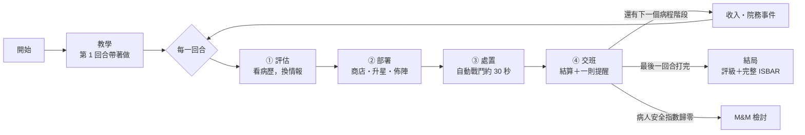

# 遊戲流程提案 v1

> 2026-11-11｜**這是提案，等你改。** 定案後，2D 版和 3D 版都照這一份做。規則數值和臨床內容仍以 [GDD v0](GDD-v0.md) 為準。

---

## 1. 現在的流程有什麼問題

| 問題 | 說明 |
|---|---|
| 沒有一份定案的流程 | 2D 版有評估、商店、交班；3D 試作只有佈陣和戰鬥。兩邊不一樣 |
| **重複的角色是廢牌** | 羈絆只算不重複的角色，所以商店刷出已經有的人，買了沒用。自走棋最核心的樂趣「湊三張升星」完全沒有 |
| 存錢沒意義 | 只有 5 回合，利息還沒滾起來就結束了 |
| 節奏被打斷 | 每回合打完都要讀一整頁 debrief |
| 回合之間沒有期待感 | 沒有「下一回合會拿到什麼」的鉤子 |

---

## 2. 提案：一局的樣子

**一局 ＝ 值一個班，救一位病人。**



### 一回合的四拍

| 拍 | 玩家做什麼 | 畫面（3D 版） | 時間 | 學什麼 |
|---|---|---|---|---|
| **① 評估** | 看病歷卡，點出異常值，選評估工具 | 病歷卡蓋在畫面上；判讀越準，病灶區越多敵人從霧裡現形 | 20–40 秒，不計時 | 篩檢工具、判讀（LO1） |
| **② 部署** | 逛商店、買人、**湊三張升星**、排站位 | 棋盤＋下方商店 5 張卡＋候補席 | 不計時（可開計時挑戰） | Bundle 要素、時效排序（LO2、LO3） |
| **③ 處置** | 看戰鬥，可調速度 | 角色依站位出手；bundle 元素在執行的那一刻亮起 | 約 30 秒 | 看見「順序」和「60 分鐘」的後果 |
| **④ 交班** | 讀一行結果＋**一則**最重要的指引提醒 | 結算卡；想看完整版再點開 | 10 秒 | 指引對照（LO3、LO4） |

完整的 ISBAR debrief 移到**整局結束**時做一次（LO5），不再每回合都跳。

### 回合之間

- **收入**：基本 5 點＋利息（每存 10 點 +1）＋連勝或連敗加成。
- **院務事件**：第 2、4 回合開始前三選一（和現在一樣）。
- **人力上限**：隨病程增加（3 → 7 人），代表更多支援到場。

---

## 3. 新增：升星

**同一個角色買到 3 張，自動合成 ★★。**

- 效果（草案）：處置力 ×1.6，出手間隔縮短 5 分鐘。出手變快，等於更容易趕上黃金一小時。
- 敘事：同一位成員反覆支援，團隊默契和熟練度提高。
- 和羈絆不衝突：羈絆一樣只算不重複的角色，重複的牌改成拿來升星。
- 這是讓商店「每一張牌都有用」的關鍵，也是最像聯盟戰棋的地方。

---

## 4. 和聯盟戰棋的對照

| 聯盟戰棋 | 這款遊戲 | 第一版 |
|---|---|---|
| 準備階段 | 部署（預設不計時，避免焦慮） | ✅ |
| 商店 5 張、刷新、金幣、利息 | 相同 | ✅ |
| 三張升星 | 熟練度升星 | ✅ 新增 |
| 備戰席 | 候補席 | ✅ |
| 買經驗升人口 | 人力上限隨病程增加 | ✅ 簡化 |
| 強化符文 | 院務事件 | ✅ |
| 玩家血量 | 病人安全指數 | ✅ |
| 裝備合成 | 醫材／藥物 | 第二版 |
| 選秀、玩家對戰 | 不做（對手是疾病，不是彼此） | — |
| — | **評估**：看病歷換情報 | ✅ 獨有 |
| — | **交班**：指引對照 | ✅ 獨有 |

---

## 5. 一局要多長（要你決定）

| 方案 | 內容 | 時間 | 代價 |
|---|---|---|---|
| **A. 精簡版** | 1 位病人、5 回合（現有內容） | 10–15 分鐘 | 最快做完；升星只來得及湊 2–3 次 |
| **B. 標準版** | 1 位病人、8–10 回合 | 20–25 分鐘 | 經濟和升星才玩得開；**要再加 3–5 個回合的臨床內容** |
| **C. 長局** | 2–3 位病人接力，團隊帶著走 | 30 分鐘以上 | 最像聯盟戰棋；需要第二、三位病人的內容 |

**我的建議：先做 A，把完整流程跑通；系統照 B 的規模設計。** 現有的 5 回合有測試保護，課堂上 15 分鐘也剛好。之後加回合只是加內容，不用改系統。

如果要走 B，新增的回合要放什麼需要你來定，例如：呼吸衰竭（讓 RT 有戲）、AKI、抗生素依培養結果降階、脫離升壓劑。

---

## 6. 從打開遊戲到結束

```
首頁 →（研究模式：參與者代號＋前測）→ 教學回合 → 正式一局 → 結局
                                                              ├─ 評級（依剩餘病人安全指數和 bundle 完成率）
                                                              ├─ 完整 ISBAR 交班
                                                              ├─（研究模式：後測＋匯出紀錄）
                                                              └─ 再玩一局
```

- **教學**：第 1 回合用提示帶著做一次（看病歷 → 買人 → 排站位 → 開打）。
- **結局評級**：給再玩一次的理由，也是研究上「主動重玩」的觀察點。
- **M&M 檢討**：病人安全指數歸零時進入。重點是檢討哪一回合、哪一項 bundle 出問題，不是懲罰。

---

## 7. 要請你決定的三件事

1. **一局多長？** A 精簡、B 標準、C 長局。
2. **升星要不要？** 我建議要。
3. **評估階段留不留？** 我建議留，但改得更快、更像「偵查」。如果你覺得它打斷節奏，也可以改成只在第 1、3、5 回合出現。
