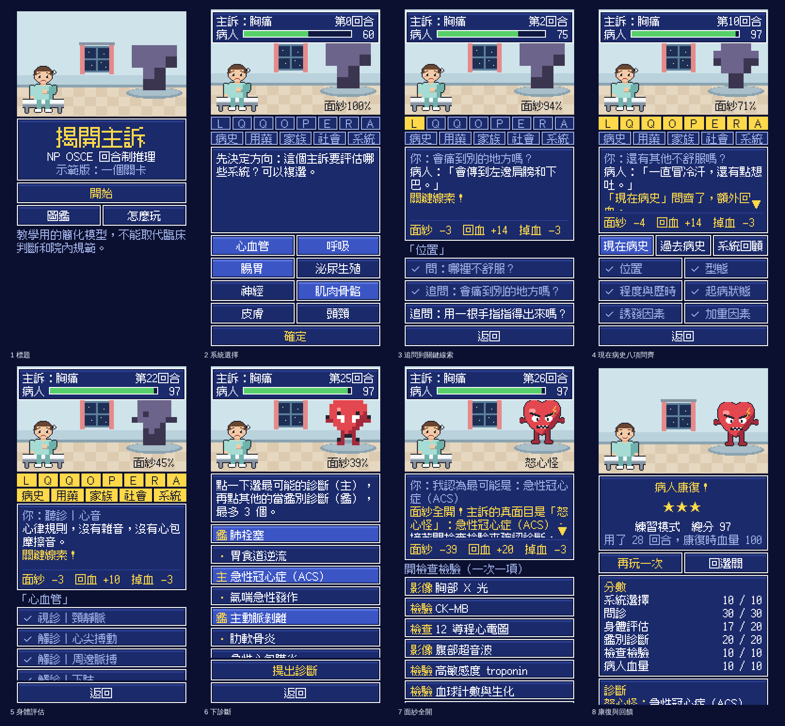

# 揭開主訴（暫定名稱）

像素風、回合制的 NP OSCE 遊戲。這個資料夾是**可以玩的空殼**：一個示範關卡，從選關玩到康復。規則核心、病例檔格式和檢查工具都在這裡。

> 示範關卡的內容還沒經過臨床專家審查，不能當教材。像素圖是佔位用的。
>
> 這個空殼的直式操作太多下、回饋太弱。[整體系統設計](../docs/04-system-design.md) 確認後，規則核心（`core/`）留用，畫面（`ui/`）會重做。



## 怎麼玩

用任何網頁伺服器打開這個資料夾。直接點兩下 `index.html` 不行，瀏覽器不讓它讀資料檔。

```bash
npx serve game
```

沒有 Node 的話：

```bash
python3 -m http.server --directory game 8000
```

## 怎麼檢查

規則核心的測試：

```bash
node --test game/core/engine.test.js game/core/validate.test.js
```

病例檢查工具。它會檢查分類表和每個病例檔，並自動試玩：

```bash
node tools/validate-cases.mjs
```

## 資料夾

```
game/
  index.html
  style.css
  core/               規則核心：純邏輯，不碰畫面
    rules.js          所有數值（掉血、回血、計分比重）
    engine.js         關卡引擎：階段、回合、面紗、血量
    scoring.js        計分和檢討
    autoplay.js       自動試玩（照規矩做、只做最低限度、一直重複問）
    validate.js       病例檢查
    *.test.js         測試
  data/
    taxonomy.json     分類表：科別、系統、13 個問診面向、身體評估項目
    cases/
      index.json      要放進遊戲的病例清單
      <id>.json       一個病例一個檔
  ui/                 畫面
  art/
    sprites.js        像素圖，用程式畫
    fonts/            像素字體和授權文件
tools/
  validate-cases.mjs  病例檢查工具
```

三層分開：加病例只動 `data/`，調規則只動 `core/rules.js`，換美術只動 `art/` 和 `style.css`。

## 加一個病例

1. 在 `data/cases/` 新增 `<id>.json`，檔名要和 `id` 一樣。
2. 把檔名加進 `data/cases/index.json`。
3. 執行 `node tools/validate-cases.mjs`，照錯誤訊息修到通過。

不用改程式。沒通過檢查的病例，遊戲會自動略過。

## 病例檔格式（第 1 版）

完整的例子看 [`data/cases/im-cv-demo-001.json`](data/cases/im-cv-demo-001.json)。

| 欄位 | 內容 |
|---|---|
| `format` | 固定是 `1` |
| `id` | 小寫英文、數字、連字號。檔名要一樣 |
| `review` | `state`：未審查、審查中、已審查。`note`：說明 |
| `specialty` | 科別代號，來自分類表（`im` 內科、`surg` 外科） |
| `systems` | 這一關歸在哪個系統底下。第一個用來在選關畫面分組 |
| `difficulty` | 初、中、高 |
| `type` | 典型、陷阱。陷阱案例要填 `trap` |
| `chief_complaint` | 主訴 |
| `acuity` | 急、亞急、慢。決定開場血量和掉血速度 |
| `patient` | `age`、`sex`、`setting`、`opening`（病人開口的第一句話） |
| `monster` | `sprite`（圖的代號）、`name`（主訴怪的名字） |
| `system_selection` | `core`、`important`、`optional` 三組系統代號 |
| `interview` | 13 個面向都要寫，見下表 |
| `physical_exam` | 和主訴相關的身體評估，見下表 |
| `differential` | 候選診斷，見下表 |
| `workup` | 檢查檢驗，見下表 |
| `teaching` | `confirmed`（檢查確認的結果）、`points`（教學重點）、`sources`（出處，每筆有 `cite`，可以加 `doi`） |

**`interview`**：面向代號是 `location`、`quality`、`quantity`、`onset`、`provoking`、`exacerbating`、`relieving`、`associated`、`pmh`、`meds`、`family`、`social`、`ros`。

| 欄位 | 內容 |
|---|---|
| `answer` | 病人的回答。`ros` 改用 `by_system`：每個系統一句，核心和重要的系統一定要寫 |
| `weight` | 1 到 3。線索的價值，決定面紗降多少、回多少血 |
| `follow_ups` | 追問。每筆有 `ask`、`answer`、`key`（是不是關鍵線索）、`weight`（0 到 3；0 代表問不到東西） |

**`physical_exam`** 的每一筆：

| 欄位 | 內容 |
|---|---|
| `item` | 分類表裡的身體評估項目代號。系統、手法、部位都從分類表來 |
| `finding` | 這位病人的發現 |
| `key` | 是不是關鍵發現。至少要有一筆 |
| `weight` | 1 到 3 |

沒列在這裡的項目，玩家做了會看到分類表裡的正常結果，並且算白白過了一回合。

**`differential`** 的每一筆：

| 欄位 | 內容 |
|---|---|
| `id`、`name` | 代號和名稱 |
| `role` | 主診斷（剛好一個）、不能漏掉、合理鑑別、干擾 |
| `note` | 為什麼是或不是它。回饋畫面會顯示 |
| `supported_by` | 只有主診斷要填：支持它的線索，至少 3 條，其中至少 1 條關鍵線索 |

線索的寫法：`interview.onset`（面向的第一次回答）、`interview.onset.0`（第 1 個追問）、`exam.cv-heart`（身體評估項目）。

**`workup`** 的每一筆：

| 欄位 | 內容 |
|---|---|
| `id`、`name` | 代號和名稱 |
| `kind` | 檢驗、影像、檢查 |
| `role` | 必要、可開可不開、不必要 |
| `result` | 結果。不必要的可以不寫 |
| `note` | 為什麼要開或不用開 |

## 檢查工具會擋下什麼

- 欄位缺漏或格式不對。
- 13 個問診面向沒寫齊。
- 沒有主診斷、沒有「不能漏掉」的診斷、沒有干擾選項。
- 主診斷的線索不夠，或指到不存在的線索。
- 沒有必要的檢查檢驗，或沒有出處。
- 自動試玩沒過：照規矩做卻沒有康復、血量餘裕太少、拿不到三顆星；只做最低限度卻沒有康復；一直重複問卻沒有失敗。

還沒通過專家審查的病例會出現提醒，但不會被擋。

## 規則的數值

都在 [`core/rules.js`](core/rules.js)。這些是架構階段的示意值，內容階段會再調。

| 項目 | 數值 |
|---|---|
| 血量上限 | 100 |
| 開場血量和每回合掉血 | 急：60、掉 5。亞急：70、掉 4。慢：80、掉 3 |
| 練習模式 | 每回合少掉 2 |
| 第一次問某個面向 | 回 3 + 2 × 權重 |
| 一整區問齊 | 多回 5 |
| 追問到一般線索 | 回 2 + 2 × 權重 |
| 追問到關鍵線索 | 回 8 + 2 × 權重 |
| 相關的身體評估 | 回 3 + 2 × 權重。關鍵發現多 2，照順序做多 1 |
| 診斷正確、錯誤 | 回 20、扣 25 |
| 必要的檢查、可開可不開的檢查 | 回 15、回 3 |
| 面紗 | 依找到的線索權重下降，最低到 10%。診斷正確才全開 |
| 計分比重 | 系統選擇 10、問診 30、身體評估 20、鑑別診斷 20、檢查檢驗 10、病人血量 10 |
| 星數 | 90 分三顆、75 分兩顆、過關一顆 |

價值最低的面向第一次問回 5，不管多急都不少於掉血，所以問得全面不會吃虧。測試會檢查這一點。

## 美術

方向是「十六位元 RPG」，見 [`docs/03-art-options.md`](../docs/03-art-options.md)。現在的圖都是用程式畫的佔位圖，只有一位病人和一隻主訴怪。

字體是 **Fusion Pixel Font** 12 像素繁體中文版（作者 TakWolf，SIL OFL 1.1），取自原作者的 2026.08.11 版，整套字都放進來了，約 670 KB。授權文件在 [`art/fonts/`](art/fonts/)。

## 還沒做

- 音效、音樂。
- 陷阱案例的「先像 A、後來變 B」。格式留了 `trap` 欄位，引擎還沒用到。
- 操作紀錄的匯出。紀錄已經存在瀏覽器裡，還沒有匯出的按鈕。
- 第二個以後的病例、外科的病例。
- 正式的像素圖。

## 示範關卡的出處

依 PubMed 查到的文獻：

- Gulati, M., Levy, P. D., Mukherjee, D., Amsterdam, E., Bhatt, D. L., Birtcher, K. K., Blankstein, R., Boyd, J., Bullock-Palmer, R. P., Conejo, T., Diercks, D. B., Gentile, F., Greenwood, J. P., Hess, E. P., Hollenberg, S. M., Jaber, W. A., Jneid, H., Joglar, J. A., Morrow, D. A., . . . Shaw, L. J. (2021). 2021 AHA/ACC/ASE/CHEST/SAEM/SCCT/SCMR guideline for the evaluation and diagnosis of chest pain. *Circulation, 144*(22), e368–e454. https://doi.org/10.1161/CIR.0000000000001029
- Thygesen, K., Alpert, J. S., Jaffe, A. S., Chaitman, B. R., Bax, J. J., Morrow, D. A., & White, H. D. (2018). Fourth universal definition of myocardial infarction (2018). *Circulation, 138*(20), e618–e651. https://doi.org/10.1161/CIR.0000000000000617

> 本遊戲為教學用的簡化模型，不能取代臨床判斷和院內 protocol。
