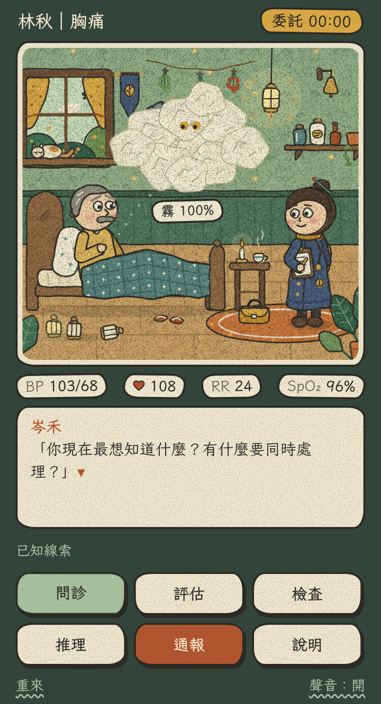
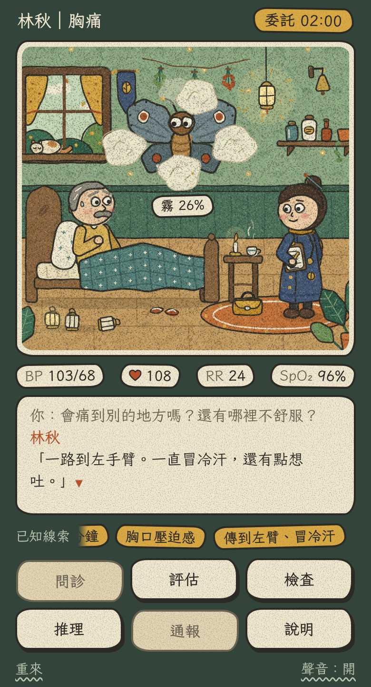

# 風格定稿（繪本版）：霧脈公會的病室

同一個場景，換成**手繪繪本**的畫法：平塗、鉛筆描邊、紙的顆粒、低彩度的大地色。
這是拿來跟 3D 像素版（`../style-frame/`）對照、決定美術方向用的。**不是遊戲本體。**



畫面裡有：林秋（第一關的病人，58 歲的製燈師傅）、岑禾（帶你的資深專科護理師）、
症影「鐵翅蛾」（胸痛這個主訴變成的怪物，一開始被霧裹住，只看得到一雙眼睛）。
地上那三盞燈是林秋搬到一半的貨：兩盞放好了，第三盞倒在地上。



## 怎麼看

在專案根目錄開網頁伺服器，再打開 `prototypes/style-frame-storybook/`：

```bash
npx serve .
```

字體（霞鶩文楷 TC）是從 Google Fonts 載入的，連不上網路時會改用系統字體。

## 可以試的

- **問診**：按三次。每問到一條線索，霧散開一些，症影越來越清楚；第三條是關鍵線索。
- **通報**：值班鐘會響。
- 不按通報、問到模擬時間第 2 分鐘：林秋的血壓會掉，人往前彎，霧從四周湧進來。
- 其他四個按鈕還沒有接上。

## 畫法

- 整個場景用 Canvas 畫，寫在 `scene.js`，沒有任何圖檔。
- 每個形狀都是「幾個點 → 每個點抖一點 → 連成平滑的線」，先平塗顏色，再用鉛筆色描兩次邊。
  顏色和線故意稍微錯開，像印刷沒對準。
- 最後整張蓋上一層紙的顆粒。
- 會動的東西每秒換五次抖動，線條會微微地晃，像一張一張手畫的。背景只畫一次。
- 小動作：呼吸、眨眼、皺眉、揉胸口、冒冷汗、寫紀錄、說話時嘴巴動、點頭、拍翅、掉鱗粉、
  雲的飄動、吊燈和螢火蟲、窗簾、旗子、草藥、茶的熱氣、窗外的雲、落葉和鳥、貓的呼吸和尾巴。
- 介面是紙片：手畫的圓角框、按下去會壓扁的按鈕、蓋章一樣跳出來的線索。

## 要知道的

- 畫風的方向來自使用者提供的手繪繪本風參考圖。參考圖沒有收進這個專案；
  這裡的角色、房間和構圖都是重新設計的，沒有使用對方的任何圖像。
  如果正式上線想要的是某位插畫家本人的味道，應該直接找對方合作或授權。
- 圖是用程式畫的，細緻度比不上真的插畫家。這張定稿要確認的是方向。
- 對話和生命徵象取自企劃裡的示範病例，還沒經過臨床老師審查。
- 只在電腦上的模擬手機視窗測過，沒有在真的手機上測。
