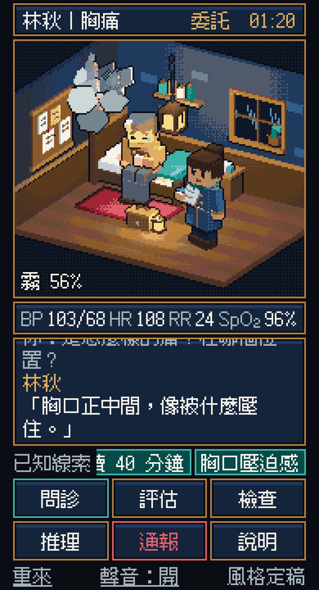

# 風格定稿：霧脈公會的病室

一個會動的畫面，用來確認美術風格。**不是遊戲本體。**



畫面裡有：病室、林秋（第一關的病人）、岑禾（帶你的資深專師）、症影「鐵翅蛾」（胸痛這個主訴變成的怪物，被霧裹住）。

## 怎麼看

在專案根目錄開網頁伺服器，再打開 `prototypes/style-frame/`：

```bash
npx serve .
```

3D 繪圖的程式庫是從網路載入的，所以要連得上網路。

## 可以試的

- **問診**：按三次。每問到一條線索，霧會被推開一層，症影越來越清楚；第三條是關鍵線索。
- **通報**：值班鐘會響。
- 不按通報、問到模擬時間第 2 分鐘：林秋的血壓會掉，人往前彎。這是「延遲會有後果」的示範。
- 其他四個按鈕還沒有接上。

## 畫法

- 所有東西都是方塊堆出來的 3D 模型，寫在 `scene.js`，沒有外部的圖檔或模型檔。
- 先用很低的解析度算圖，每個像素再對到一組固定的 34 色色盤，輪廓加一條深色的線，最後整數倍放大。
- 動作都是移動和旋轉零件：呼吸、眨眼、拍翅、霧的飄動、吊燈的火光、窗外的雨。
- 介面用像素字體（Fusion Pixel Font），配色是墨藍、銅金、霧白、青綠。
- 聲音是程式合成的電子音。

## 要知道的

- 模型是我用程式堆的第一版，還很粗。這張定稿要確認的是方向，不是完成度。
- 對話和生命徵象取自企劃裡的示範病例，還沒經過臨床老師審查。
- 只在電腦上的模擬手機視窗測過，沒有在真的手機上測。
